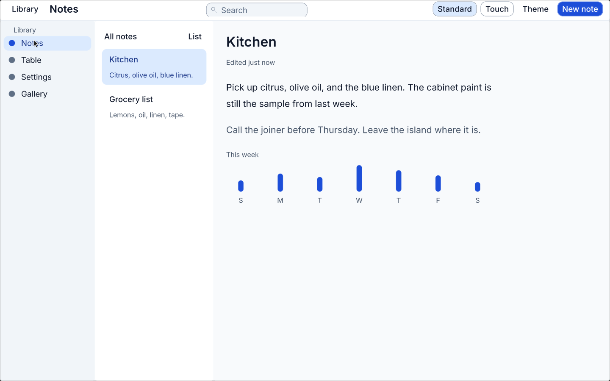
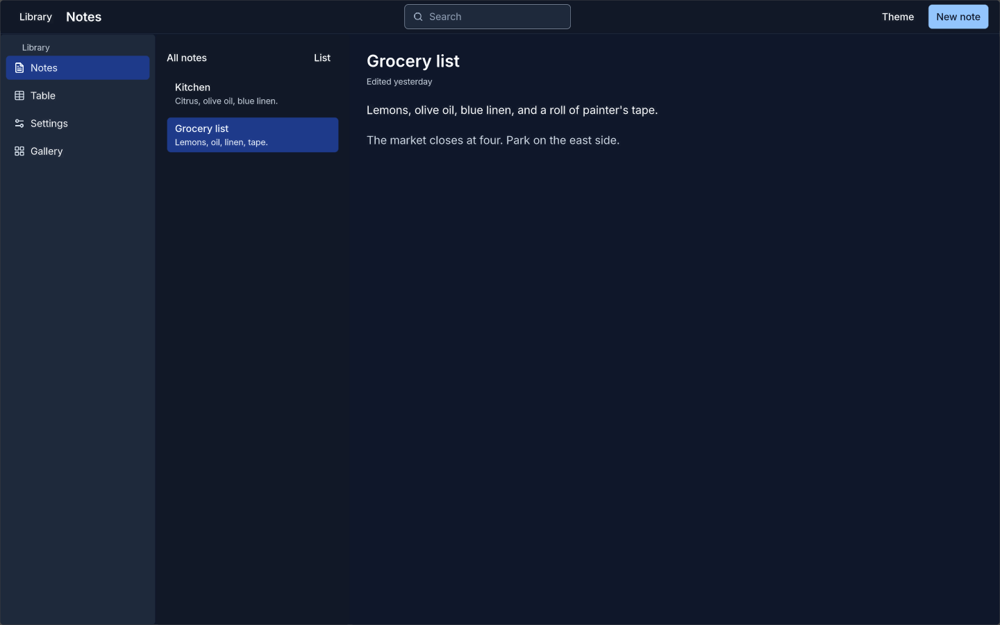
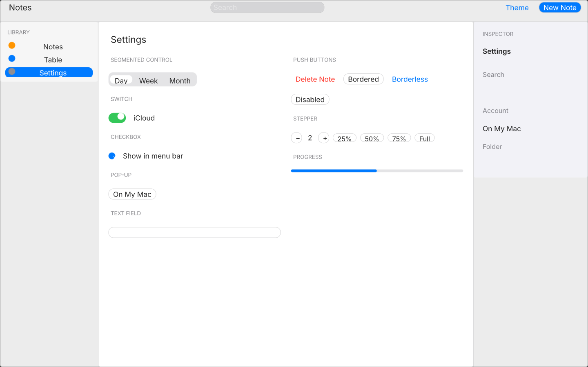
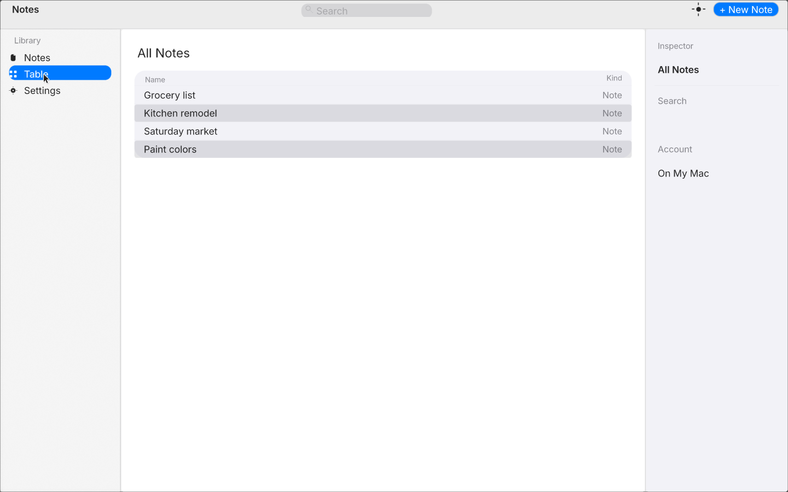
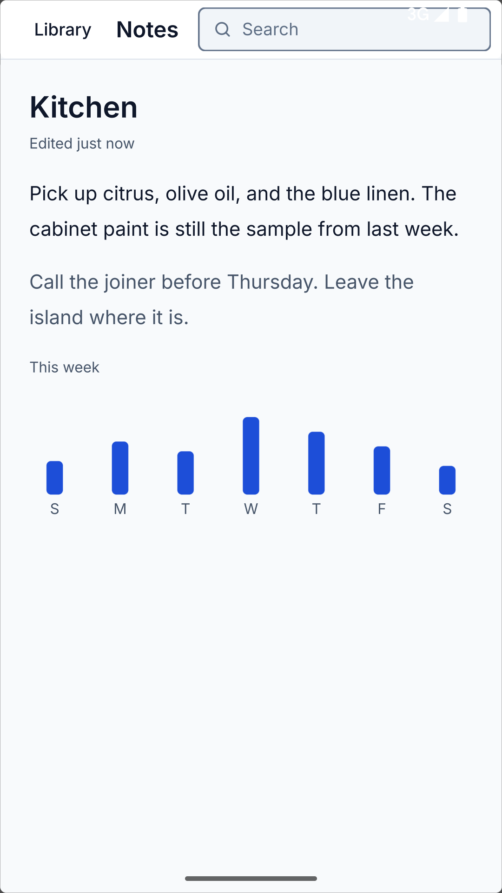

# quinn

Leptos-style components, rendered by Makepad. There is no WebView and no second layout engine.

The showcase is the Notes, Table, Settings, and component gallery window (`examples/showcase`). Its visual contract is [docs/design-system-prd.md](docs/design-system-prd.md): slate surfaces, accent `#1D4ED8`, and the density and shell rules in [docs/design-system.md](docs/design-system.md). Notes, light, at 1440×900:

<p align="center">

</p>

<details>
<summary>More screenshots (Notes dark, Settings, Table, Android)</summary>

<p>Light and dark Notes, plus Settings and Table, each 1440×900 and shown smaller here. The phone shot is the same Notes screen on the Android 15 release APK (<code>dev.makepad.showcase</code>), 1080×1920. Shots from the previous pass are in <a href="docs/images/before/"><code>docs/images/before/</code></a>.</p>

<table>
<tr>
<td width="50%" align="center">
<br>
<sub>Notes, light</sub>
</td>
<td width="50%" align="center">
<br>
<sub>Notes, dark</sub>
</td>
</tr>
<tr>
<td width="50%" align="center">
<br>
<sub>Settings, light</sub>
</td>
<td width="50%" align="center">
<br>
<sub>Table, light</sub>
</td>
</tr>
</table>

<p align="center">
<br>
<sub>Notes on Android 15 (<code>dev.makepad.showcase</code>)</sub>
</p>

</details>

## Features

- `view!`, `#[component]`, and signals, written in `view.rs` and lowered into a Makepad `script_mod!`
- One renderer. Class strings become layout fields Makepad already has
- `--hot` reloads `view.rs` in the same process. A save of `src/main.rs` still rebuilds
- Light and dark from the design system in `quinn-styles`
- Headless tests for the reactive core, with no GPU and no display

## Quick start

Rust 1.99.0 is pinned in [`rust-toolchain.toml`](rust-toolchain.toml).

### Test the reactive core

This does not need a GPU or a display:

```bash
cargo test -p quinn-styles -p quinn-reactive -p quinn-core -p quinn-lower -p quinn --no-default-features
```

### Run a native example

Linux, software OpenGL (llvmpipe) under Xvfb:

```bash
export MAKEPAD_GPU=gl
export LIBGL_ALWAYS_SOFTWARE=1
cargo run -p counter --release -- --hot
```

Edit [`examples/counter/view.rs`](examples/counter/view.rs) while that process is up. The same command works for `conditional`, `keyed-list`, `form`, `retain`, `tailwind-gallery`, `app-shell`, `async-dashboard`, and `showcase`. Saving `src/main.rs` still rebuilds. `baseline-counter` and `probe-widget-lifecycle` are hand-written Makepad programs; they have no `view.rs`. `showcase` is the Notes window (navigation, collection, editor, inspector, and the component gallery) and is the place to look at the design system. `async-dashboard` and the other themed examples call `quinn::drive_shell` so resources, the dark flag, and the window width update without a rebuild.

`xvfb-run -a cargo run -p counter --release` still starts a window when you are not reloading. Drop `xvfb-run -a` if `DISPLAY` is already a real X server. Package names for a Linux machine, and the Android toolchain and emulator, are in [docs/SETUP_LINUX_AND_ANDROID.md](docs/SETUP_LINUX_AND_ANDROID.md). The showcase production APK is [docs/ANDROID.md](docs/ANDROID.md). On macOS, leave both GPU variables unset and follow [docs/TESTING_ON_MACOS.md](docs/TESTING_ON_MACOS.md).

## Usage

```rust
use quinn::prelude::*;

#[component]
fn Counter() -> impl IntoView {
    let (count, set_count) = signal(0);

    view! {
        <div class="flex flex-col gap-4 p-4">
            <h1>"Counter: " {move || count.get()}</h1>
            <button on:click=move |_| {
                set_count.update(|n| *n += 1);
            }>"Increment"</button>
        </div>
    }
}

quinn::run!("Counter", 480, 360, view! { <Counter /> });
```

The syntax above is what you write in `view.rs`. The running examples lower it into a Makepad `script_mod!` (`mod.state`, `on_render`, `on_click`, `on_change`) so `--hot` can reload the view in the same process. `view.rs` is not a Rust module. `run!` still expands to an `app_main!` shell for a compiled component, and the headless tests still use `reactive_graph`. The example windows do not. The lowering is described in [docs/architecture.md](docs/architecture.md).

## Configuration

Harness variables. `counter` and `baseline-counter` read the shared set below.

`QUINN_EXIT=1` asks `counter`, `baseline-counter`, and `retain` to quit after the first presented frame. `QUINN_READY=/tmp/ready` writes `ready` from Makepad's `post_draw_hook`, after that frame's draw lists are recorded and before swap. The lifecycle probe writes `artifacts/probe-widget-lifecycle.log` and quits with a failure status when `QUINN_PROBE_EXIT=1` if any of the eight checks failed.

| Variable | Effect |
| --- | --- |
| `QUINN_LATENCY=80` | Eighty signal-to-next-presented-frame samples, then quit |
| `QUINN_LIVE=1` | Inject one synthetic script reload in-process. This does not edit a file. Disk reload is `--hot` |
| `QUINN_WIDGET_BENCH=200` | Time creating 200 labels and updating their text |
| `QUINN_RETAIN=2000` | On `retain` only: two bursts of mount/unmount cycles |

`QUINN_RETAIN=2000 cargo run -p retain --release` prints the script census and RSS, then quits. Do not set `QUINN_EXIT=1` with it: that flag quits on the first frame. Widgets and buttons return to the resting tree (4 widgets, 1 button, 2 host children at rest for the current view). `session_stats()` stays empty because the Rust graph is not mounted.

## Workspace

- `crates/styles` — semantic tokens, type scale, density, and shell breakpoints, plus the Tailwind palette. See [docs/design-system.md](docs/design-system.md).
- `crates/ui` — component library (`Button`, `Field`, `NavRow`, and the rest). `components.rs` is authoring source. See [docs/components.md](docs/components.md).
- `crates/reactive` — upstream `reactive_graph`
- `crates/core` — owners, surface, lifecycle tests
- `crates/lower` — lowers `view.rs` (`Show`, `For`, inputs, clicks) into Makepad script
- `crates/macros` — `view!`, `#[component]`, `run!`
- `crates/makepad` — the only renderer
- `crates/quinn` — what applications import
- `examples/` — counter, conditional, keyed list, form, retain, Tailwind gallery, app shell, async dashboard, showcase, and a Makepad baseline. The gallery is the P0 utilities (wrap, distribute, row align, flex weight, fractions, per-side spacing, arbitrary values, `class:`, button hover, and a show inside a row). The baseline keeps the button and the label inside a `height: Fill` client view, with light text on a dark button, so neither sits in the title band.
- `probes/widget-lifecycle` — the Makepad tree experiment
- `docs/` — design system, architecture, benchmarks, the showcase APK, and the platform notes linked below

## Documentation

- [Design system PRD](docs/design-system-prd.md)
- [Token reference](docs/design-system.md)
- [Component specs](docs/components.md)
- [Architecture](docs/architecture.md)
- [Decisions](docs/decisions.md)
- [Compatibility](docs/compatibility.md) — platforms, markup and style subset, dependency licenses
- [Benchmarks](docs/benchmarks.md)
- [Research](docs/research.md)
- [Gap analysis](docs/gap-analysis.md)
- [Roadmap](docs/roadmap.md)
- [Verification matrix](docs/verification-matrix.md)
- [Linux and Android setup](docs/SETUP_LINUX_AND_ANDROID.md)
- [Android](docs/ANDROID.md)
- [Testing on macOS](docs/TESTING_ON_MACOS.md)

## License

MIT OR Apache-2.0 (`Cargo.toml`). Notices for Makepad, `reactive_graph`, and rstml are in [docs/compatibility.md](docs/compatibility.md).
