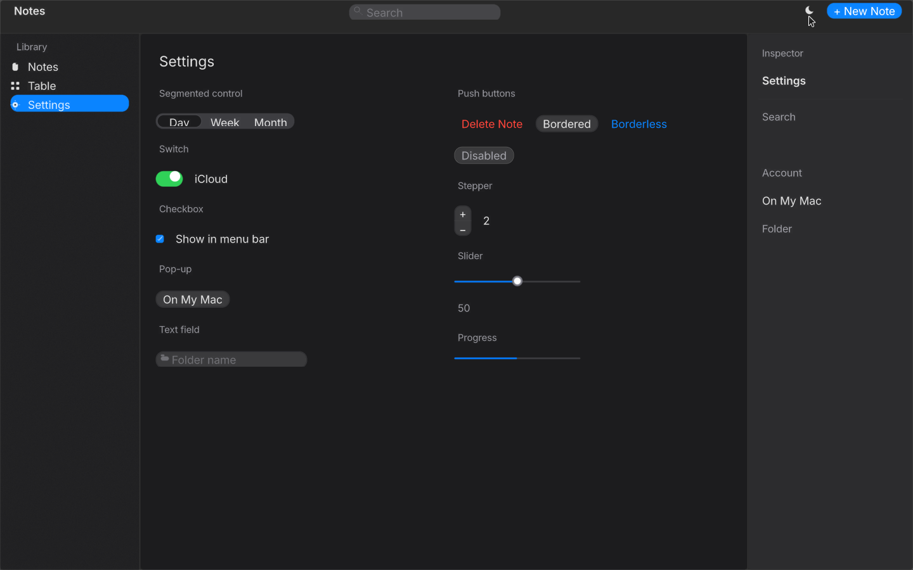

# Design system

Quinn’s look is Apple’s [Human Interface Guidelines for macOS](https://developer.apple.com/design/human-interface-guidelines/designing-for-macos). One system, used as published: [typography](https://developer.apple.com/design/human-interface-guidelines/typography), [color](https://developer.apple.com/design/human-interface-guidelines/color), [materials](https://developer.apple.com/design/human-interface-guidelines/materials), [layout](https://developer.apple.com/design/human-interface-guidelines/layout), and the standard controls ([buttons](https://developer.apple.com/design/human-interface-guidelines/buttons), [toggles](https://developer.apple.com/design/human-interface-guidelines/toggles), [text fields](https://developer.apple.com/design/human-interface-guidelines/text-fields), [sidebars](https://developer.apple.com/design/human-interface-guidelines/sidebars)).

The names are Tailwind-shaped utilities in `quinn-styles` (`text-headline`, `bg-system-background`, `text-label-secondary`, `accent-blue`). The full Tailwind v3 hue palette (22 hues, steps 50–950, plus `white`, `black`, and `transparent`) stays available. An unknown token fails the lower (`unknown class: …`) and the previous script stays on screen.

`examples/showcase` is the native window: sidebar, toolbar, content, inspector, in light and dark.

## Type

SF Pro cannot be redistributed. Every text node uses the variable Inter that Makepad already ships at `makepad_widgets/resources/Inter.ttf`. Example binaries pass `makepad_platform::INTER_FONT_ASSET` to `app_main!`. Weight is the `wght` axis. There is no CSS inheritance: each text node sets its own `text-*` color.

The scale is the macOS text styles, in points. Line spacing is line-height / size.

| Utility | Style | Size | Weight | Line |
| --- | --- | --- | --- | --- |
| `text-large-title` | Large Title | 26 | 400 | 32 |
| `text-title1`, `text-title` | Title 1 | 22 | 400 | 26 |
| `text-title2` | Title 2 | 17 | 400 | 22 |
| `text-title3` | Title 3 | 15 | 400 | 20 |
| `text-headline` | Headline | 13 | 600 | 16 |
| `text-body` | Body | 13 | 400 | 16 |
| `text-callout` | Callout | 12 | 400 | 15 |
| `text-subheadline` | Subheadline | 11 | 400 | 14 |
| `text-footnote` | Footnote | 10 | 400 | 13 |
| `text-caption` | Caption 1 | 10 | 400 | 13 |
| `text-caption2` | Caption 2 | 10 | 500 | 13 |

A later `font-bold` / `font-semibold` / `font-medium` overrides the weight. `text-xs` through `text-3xl` are still the Tailwind sizes.

Unstyled tags follow the same scale: `h1` is Title 1, `h2` is Title 2, body text is 13 pt, a push button and a text field are 13 pt.

## Color

System colors use the published sRGB pairs. `dark:` reads the dark value. Tailwind hues do not flip.

| Name | Light | Dark |
| --- | --- | --- |
| `system-blue`, `accent`, `accent-blue` | `#007AFF` | `#0A84FF` |
| `system-green` | `#34C759` | `#30D158` |
| `system-indigo` | `#5856D6` | `#5E5CE6` |
| `system-orange` | `#FF9500` | `#FF9F0A` |
| `system-pink` | `#FF2D55` | `#FF375F` |
| `system-purple` | `#AF52DE` | `#BF5AF2` |
| `system-red` | `#FF3B30` | `#FF453A` |
| `system-teal` | `#30B0C7` | `#40C8E0` |
| `system-yellow` | `#FFCC00` | `#FFD60A` |
| `system-gray` | `#8E8E93` | `#8E8E93` |
| `system-gray2` … `system-gray6` | the system gray ramp | the dark ramp |

Semantic colors, with the published alpha:

| Name | Light | Dark |
| --- | --- | --- |
| `label` | black 85% | white 85% |
| `label-secondary` | `rgb(60 60 67 / 60%)` | `rgb(235 235 245 / 60%)` |
| `label-tertiary` | `rgb(60 60 67 / 30%)` | `rgb(235 235 245 / 30%)` |
| `label-quaternary` | `rgb(60 60 67 / 18%)` | `rgb(235 235 245 / 18%)` |
| `separator` | `rgb(60 60 67 / 29%)` | `rgb(84 84 88 / 65%)` |
| `system-background` | `#FFFFFF` | `#1C1C1E` |
| `system-background-secondary` | `#F2F2F7` | `#2C2C2E` |
| `system-grouped-background` | `#F2F2F7` | `#000000` |
| `window-background` | `#ECECEC` | `#282828` |
| `control-background` | `#FFFFFF` | `#3A3A3C` |
| `sidebar` | `rgb(246 246 246 / 92%)` | `rgb(32 32 34 / 92%)` |
| `system-fill` and the secondary, tertiary, and quaternary fills | the system fill alphas | the dark fill alphas |

`bg-sky-100` is `#E0F2FE`. A missing name such as `bg-not-a-color` is an error from `lower_file`, not a silent drop.

## Materials, radii, shadows, controls

The sidebar uses the `vibrancy` utility. That lowers to Makepad’s `GaussRoundedView`: a render-to-texture of the window scene, a blur pyramid (`gauss_view.rs`), and a tint. It is not `NSVisualEffectView`. The texture is the app’s own scene, not the desktop wallpaper, so a sidebar beside the content frosts the window fill. A sheet or toast drawn over the content can frost that content. `fallback_color` matches the sidebar tint, so a failed capture (software GL often looks flat) still reads as a solid sidebar. `MAKEPAD_NO_GAUSS=1` forces the opaque fallback.

| Utility | Value |
| --- | --- |
| `rounded-control-sm` | 5 pt |
| `rounded-control` | 6 pt |
| `rounded-control-lg` | 8 pt |
| `rounded-window` | 10 pt |
| `rounded-sheet` | 12 pt |
| `h-control-mini` | 16 pt |
| `h-control-small` | 18 pt |
| `h-control`, `h-control-regular` | 22 pt |
| `h-control-large` | 28 pt |
| `shadow-control` | radius 8, offset 2 |
| `shadow-window` | radius 24, offset 8 |
| `ring` | 2 pt stroke in `system-blue` |

`shadow` still paints `#0006`. `border-0` sets a zero stroke so a borderless button and a selected source-list row do not keep the hairline.

## Icons

[SF Symbols](https://developer.apple.com/sf-symbols/) cannot be redistributed. Makepad’s `Button` `DrawSvg` path tints a whole silhouette white, so a Lucide stroke would not stay a stroke. The showcase draws small vector marks from rounded views: a page, a four-cell table, a gear, a magnifying glass, a folder, a sun, and a moon. They are not SF Symbols and not Lucide paths. Inter does not draw “✓” or “▾”; the checkbox check is a few white blocks.

## Controls

These are Makepad `Button`, `TextInput`, and `RoundedView` widgets wearing the utilities. They are not AppKit controls.

| HIG control | How the showcase draws it |
| --- | --- |
| Push button, default | `bg-system-blue text-white`, 6 pt radius, 28 pt |
| Push button, bordered | `bg-control-background` and a `separator` hairline |
| Push button, borderless | `border-0 bg-transparent text-system-blue` |
| Segmented control | a `system-fill` track; the selected segment is a `system-background` pill with a hairline, and the label is a transparent button on top |
| Toggle | a 44×26 pill, `system-fill` off and `system-green` on, with a white knob |
| Checkbox | a 14 pt rounded square; accent-filled with a block check when on, bordered when off |
| Pop-up button | a bordered button that shows a shadowed menu |
| Text field | 28 pt, `separator` stroke; focus sets `border_color_focus` to system blue (`#007AFF` light, `#0A84FF` dark) inside the view script |
| Search field | `system-fill`, a drawn magnifying glass, placeholder in `tertiaryLabel` (`#3C3C434D` light, `#EBEBF54D` dark) |
| Sidebar source list | full window height, 28 pt rows, icon then label, selection inset 10 pt, section header 11 pt in the secondary label color |
| Toolbar | 52 pt, headline title on the left, icon buttons, a hairline; Theme is a sun/moon toggle in the showcase |
| Toast | a floating rounded card with a shadow, not a full-width bar. A root-level `absolute` child is lifted onto the host overlay and shrink-wraps unless it sets a width |
| Sheet | a portal card, 12 pt radius, over a translucent scrim |
| Alert | a smaller sheet with a `system-red` default button |
| Popover | the pop-up menu, `shadow-window` |
| Table | `<For let:item let:index>` passes the enumerate index. `odd:` / `even:` paint zebra rows |
| Slider | a track, a `system-blue` fill, and a knob. `bind:width="level*2"` and `bind:width="level*2-9"` place the fill and the knob. Clicks set the value; it does not drag |
| Stepper | one joined vertical control. Handlers use `if` / `else` and `clamp` |
| Progress | the same fill as the slider |
| Tab view | the source list is the tab. Settings also has the segmented control |

A click used to leave a button pale grey with a faint label. The theme’s pressed and focus fills were mixed in and could stick across `render()`. Every button state now uses the face and label already chosen, the outset gradient is turned off (`color_2` alpha is negative), and `reset_hover_on_click` cuts the hover track after the click. The focus ring is the border, in system blue, and the view script uses the dark accent when `quinn_dark` is on. The host `control_script` patch still uses `#007AFF`, because that patch runs outside the view script.

`class:` reads both palettes, so `class:bg-system-blue` is `#0A84FF` in dark mode. `class:dark:token=signal` applies only when the signal is on and `quinn_dark == 1`.

Handlers can branch: `if` / `else` / `else if`, comparisons, and `min` / `max` / `clamp`. `bind:width` takes `"signal"`, `"signal*factor"`, or `"signal*factor-bias"`.

A `md:flex-row items-stretch` parent gives its children a full height at that breakpoint, so a sidebar and an inspector meet the bottom of the window. The separator uses `md:h-full`.

## Layout

The showcase follows the HIG window: sidebar, content, inspector, with the toolbar across the top. Content padding is 24 pt. Controls sit 8–12 pt apart. Below 768 pt (`md:`) the three columns stack. `drive_shell` writes `state.quinn_width` on resize and is what makes `md:` follow the window.

Light and dark are `state.quinn_dark`, toggled by `toggle_theme()`. The switch is instant. The window fill is a child of the host, because the host does not repaint its own background when `on_render` runs again. Button hover and press still use Makepad’s 0.1 s and 0.2 s tracks.

## Other limits

- Real keystrokes and IME `insertText:` reach a `TextInput`. Accessibility synthetic typing does not. The macOS view has no `AXValue` or `AXSelectedText`, so XCUITest `typeText` does not land in the field. See [Testing on macOS](TESTING_ON_MACOS.md).
- The first click on an unfocused window is delivered only after `patches/makepad-accepts-first-mouse.patch`. AppKit’s `acceptsFirstMouse` returned `NO` for content, which swallowed the activating click. This machine is Linux, so that path was not executed here. On a Mac, apply the patch to the Makepad checkout and run `cargo clean -p makepad-platform` before building. Cargo fingerprints the git revision, not the edited file.
- `Action::version` (`save.version()`) is 0 until the first `dispatch`. A resource’s generation still starts at 1 so the initial load runs.
- Gradients are two stops, linear. There is no `animate-spin`.
- The slider does not drag. Eight transparent buttons set the value.
- `GaussRoundedView` blurs the app scene, not the wallpaper. On this machine’s software GL the sidebar reads as a flat tint.
- Source-list icons are built from rounded rectangles. They are not SF Symbols.
- A `RoundedShadowView` smaller than the shadow padding can lose its face. The selected segment is a plain rounded view with a hairline, not a shadow widget.
- The host focus ring stays `#007AFF`. Only the view script flips it to `#0A84FF`.
